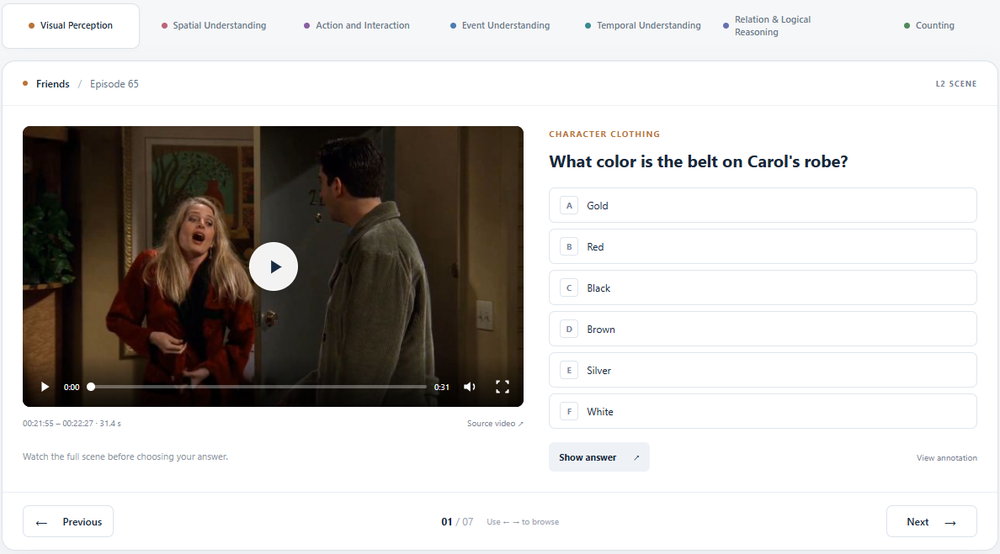

<div align="center">

<h1>DramaVQA</h1>
<p><strong>Probing Detailed Understanding of Ultra-Long TV Dramas</strong></p>

<a href="https://arxiv.org/abs/2611.00769"></a>
<a href="https://huggingface.co/datasets/198808xc/drama_bench_data"></a>
<a href="LICENSE"></a>

<p><a href="https://arxiv.org/abs/2611.00769">Paper</a> · <a href="#question-categories">Categories</a> · <a href="#qa-examples">QA Examples</a> · <a href="#data">Data</a> · <a href="#evaluation">Evaluation</a> · <a href="#leaderboard">Leaderboard</a> · <a href="#citation">Citation</a></p>

</div>

<a name="overview"></a>

## 🎬 Overview

DramaVQA benchmarks detailed understanding of ultra-long TV dramas. We process **15 dramas totaling approximately 606 hours**: **12 dramas (466 hours)** form the evaluation benchmark, and **3 additional dramas** form a separate training split with **86,736 questions**.

The evaluation benchmark includes **20,000 single-point questions (Full)**, a **2,000-question single-point Mini subset**, **3,200 multi-point questions**, and **1,200 multi-hop questions**. These tasks probe detailed visual understanding, information integration, and reasoning across long narratives.

<a name="data-generation"></a>

### ⚙️ Data generation

Metadata extraction and hierarchical captioning are followed by QA generation, filtering, human verification, and global uniqueness checks.

<p align="center">
  <a href="assets/data_generation_pipeline.png"></a>
</p>

<a name="question-categories"></a>

### 🧩 Question categories

**7 major categories · 28 subcategories**

<p align="center">
  <a href="assets/question_categories.png"></a>
</p>

**Categories and subcategories · 20,000 questions**

| Category | Questions (Full) | Subcategories |
| --- | ---: | --- |
| Visual Perception | 4,966 | Character Clothing; Character Hairstyle; Distinctive Features; Object Appearance; Object Presence; Season and Weather; Scene and Location; Textual Content |
| Spatial Understanding | 1,409 | Spatial Location; Position Comparison; Shooting Perspective |
| Action and Interaction | 5,290 | Body Movement; Action Claim Subject; Action Recipient; Object Motion |
| Event Understanding | 1,981 | Event Summary; Event Background; Event Outcome; Character Motivation |
| Temporal Understanding | 2,710 | Character Change; State Transition; Temporal Sequence; Temporal Comparison |
| Relation & Logical Reasoning | 1,868 | Human-Object Relation; Character Relation; Causal Inference |
| Counting | 1,776 | Object Counting; Quantity Comparison |
| **Total** | **20,000** | **28 subcategories** |

<a name="qa-examples"></a>

## 🎞️ QA Examples

Explore one question from each of the **7 major categories**, paired with its **L2 video scene**. Switch examples with the arrows and reveal the answer after watching.

<p align="center">
  <a href="https://xinyuehuo.github.io/DramaVQA/"></a>
</p>

<p align="center"><a href="https://xinyuehuo.github.io/DramaVQA/"><strong>Open the interactive gallery →</strong></a></p>

<a name="data"></a>

## 📦 Data

Question annotations are included in this repository. Videos and metadata are available on [Hugging Face](https://huggingface.co/datasets/198808xc/drama_bench_data).

| Collection | Directory | Questions | Dramas |
| --- | --- | ---: | ---: |
| Single-point Full | [`DramaVQA/Bench_Data/`](DramaVQA/Bench_Data/) | 20,000 | 12 |
| Single-point Mini | [`DramaVQA/Bench_Data_mini_2000/`](DramaVQA/Bench_Data_mini_2000/) | 2,000 | 12 |
| Multi-point | [`DramaVQA/Multi-Point/`](DramaVQA/Multi-Point/) | 3,200 | 12 |
| Multi-hop | [`DramaVQA/Multi-Hop/`](DramaVQA/Multi-Hop/) | 1,200 | 12 |
| Training | [`DramaVQA/Training_Set/`](DramaVQA/Training_Set/) | 86,736 | 3 |

Mini is a subset of Full. The three training dramas are separate from the evaluation dramas.

<a name="download"></a>

### 📥 Download

Clone the repository and download media for one evaluation drama, for example [*The Knockout* (狂飙)](DramaVQA/Bench_Data/the_knockout.json):

```bash
git clone https://github.com/xinyuehuo/DramaVQA.git
cd DramaVQA
python -m pip install --upgrade huggingface_hub
hf download 198808xc/drama_bench_data --repo-type dataset \
  --include "the_knockout/*" --local-dir data/drama_bench_data
```

Change `--include` for another drama, or omit it to download all media.

<a name="evaluation"></a>

## 🧪 Evaluation

Single-point QA is evaluated across four temporal tracks:

| Track | Average input duration |
| --- | --- |
| Medium | 7.6 minutes |
| Long | 43.1 minutes |
| Extra-Long | 9.3 hours |
| Ultra-Long (full drama) | 38.9 hours |

See the **[Evaluation Guide](evaluate/README.md)** for single-point, multi-point, and multi-hop evaluation, including setup and the **validate → prepare → run** workflow.

<a name="leaderboard"></a>

## 🏆 Leaderboard

Ranked by **Medium (L3)** accuracy.

**Frames:** sampled frames (`var` = variable). **Think:** ✓ on / — off. <sup>P</sup>: proprietary model.

<!-- Transcribed from the active tab:main_results in iclr_dramavqa_release.tex.
     Each LaTeX cell is Mini accuracy / Full accuracy / Mini inference time.
     Preserve model labels and settings from that table, not commented drafts. -->

<details open>
<summary><strong>Mini · 2,000 questions</strong></summary>

| Rank | Model | Frames | Think | Medium | Long | Extra-Long | Ultra-Long |
| :--: | --- | ---: | :--: | ---: | ---: | ---: | ---: |
| 🥇 1 | Gemini-3.5-Flash<sup>P</sup> | 256 | — | **77.5** | **61.2** | **43.9** | **37.1** |
| 🥈 2 | GLM-5.3-Flash-FP8 | 512 | ✓ | 75.4 | 56.1 | 36.1 | 32.1 |
| 🥉 3 | Seed2.0 Pro<sup>P</sup> | 256 | ✓ | 73.2 | 49.2 | 32.2 | 30.7 |
| 4 | Qwen3.6-27B | 512 | — | 72.5 | 55.0 | 37.9 | 34.1 |
| 5 | Qwen3.5-27B | 512 | — | 72.2 | 51.0 | 37.1 | 33.9 |
| 6 | GLM-5.3-Flash-FP8 | 256 | ✓ | 70.5 | 49.9 | 34.9 | 32.1 |
| 7 | Qwen3.6-27B | 256 | — | 69.9 | 48.0 | 35.2 | 33.0 |
| 8 | Qwen3.5-27B | 256 | — | 69.4 | 47.1 | 35.7 | 34.4 |
| 9 | GPT-5.5<sup>P</sup> | 256 | — | 67.2 | 45.2 | 29.9 | 27.6 |
| 10 | LongVideo-R1 (post-tuned) | var | ✓ | 66.1 | 60.0 | 40.0 | 30.8 |
| 10 | Qwen3-VL-32B | 512 | ✓ | 66.1 | 43.7 | 26.4 | 24.1 |
| 12 | LongVideo-R1 | var | ✓ | 62.8 | 54.8 | 34.7 | 27.2 |
| 13 | Qwen3-VL-32B | 256 | ✓ | 62.0 | 37.9 | 26.4 | 24.9 |
| 14 | GLM-4.6V-106B | 512 | ✓ | 60.8 | 40.1 | 25.6 | 24.6 |
| 15 | Naive-RAG (Q3.8) | var | — | 60.1 | 56.7 | 36.9 | 31.5 |
| 16 | Qwen3-VL-8B | 512 | ✓ | 57.2 | 40.0 | 26.9 | 25.0 |
| 17 | GLM-4.6V-106B | 256 | ✓ | 57.1 | 36.6 | 27.1 | 25.4 |
| 18 | RAG-BS (Q3.8) | var | — | 56.4 | 40.4 | 32.1 | 30.9 |
| 19 | GLM-4.6V-106B | 512 | — | 55.0 | 37.0 | 27.4 | 26.6 |
| 20 | Qwen3-VL-32B | 512 | — | 54.8 | 35.8 | 28.2 | 25.4 |
| 21 | Qwen3-VL-8B | 256 | ✓ | 54.2 | 36.5 | 24.6 | 23.4 |
| 22 | Naive-RAG (Q3) | var | — | 51.7 | 46.6 | 29.7 | 26.3 |
| 23 | GLM-4.6V-106B | 256 | — | 51.0 | 34.5 | 27.4 | 26.5 |
| 23 | Qwen3-VL-32B | 256 | — | 51.0 | 35.1 | 27.8 | 26.4 |
| 25 | Conan | 512 | ✓ | 49.0 | 37.7 | 29.7 | 29.6 |
| 26 | Conan | 256 | ✓ | 48.8 | 36.3 | 29.7 | 28.6 |
| 27 | RAG-BS (Q3) | var | — | 47.4 | 33.5 | 25.8 | 24.8 |
| 28 | Qwen3-VL-8B | 512 | — | 41.7 | 30.4 | 24.1 | 22.6 |
| 29 | Qwen3-VL-8B | 256 | — | 40.9 | 28.7 | 24.8 | 22.7 |

</details>

<details>
<summary><strong>Full · 20,000 questions</strong></summary>

| Rank | Model | Frames | Think | Medium | Long | Extra-Long | Ultra-Long |
| :--: | --- | ---: | :--: | ---: | ---: | ---: | ---: |
| 🥇 1 | Qwen3.6-27B | 512 | — | **70.8** | 54.9 | 38.6 | **35.1** |
| 🥈 2 | LongVideo-R1 (post-tuned) | var | ✓ | 67.5 | **61.4** | **40.9** | 30.5 |
| 🥉 3 | Qwen3.6-27B | 256 | — | 67.1 | 49.5 | 36.9 | 34.6 |
| 4 | LongVideo-R1 | var | ✓ | 63.7 | 55.3 | 34.0 | 26.6 |
| 5 | Naive-RAG (Q3.8) | var | — | 59.8 | 56.1 | 36.8 | 32.7 |
| 6 | Qwen3-VL-8B | 512 | ✓ | 58.9 | 41.0 | 27.5 | 25.2 |
| 7 | Qwen3-VL-8B | 256 | ✓ | 56.3 | 37.7 | 26.7 | 24.9 |
| 8 | RAG-BS (Q3.8) | var | — | 56.0 | 41.1 | 32.7 | 31.5 |
| 9 | Qwen3-VL-32B | 512 | — | 53.3 | 37.2 | 27.5 | 26.2 |
| 10 | Qwen3-VL-32B | 256 | — | 51.3 | 35.0 | 27.4 | 25.9 |
| 11 | Naive-RAG (Q3) | var | — | 50.4 | 45.9 | 29.1 | 25.3 |
| 12 | Conan | 256 | ✓ | 50.1 | 37.1 | 30.9 | 29.9 |
| 13 | Conan | 512 | ✓ | 48.8 | 37.9 | 30.5 | 29.5 |
| 14 | RAG-BS (Q3) | var | — | 47.1 | 33.7 | 25.7 | 24.7 |
| 15 | Qwen3-VL-8B | 512 | — | 42.5 | 31.1 | 25.4 | 24.2 |
| 16 | Qwen3-VL-8B | 256 | — | 42.3 | 30.2 | 25.1 | 24.1 |

</details>

<details>
<summary><strong>Reference scores and settings</strong></summary>

No-vision reference scores apply to all four tracks.

| Reference | Think | Mini | Full |
| --- | :--: | ---: | ---: |
| Random guess | — | 16.2 | 16.2 |
| Language only (Q3) | — | 21.5 | 22.2 |
| Language only (Q3.5) | ✓ | 23.1 | 23.3 |

Human reference: **81.0% on Mini / Medium**.

- **Backbones:** Q3 = Qwen3-VL-32B; Q3.5 = Qwen3.5-27B; Q3.8 = Qwen3.8-27B.
- **Post-tuning:** LongVideo-R1 (post-tuned) uses our training data.
- **Settings:** see the [paper](https://arxiv.org/abs/2611.00769) and [evaluation guide](evaluate/README.md).

</details>

<a name="citation"></a>

## 📖 Citation

If you use DramaVQA in your research, please cite our [arXiv paper](https://arxiv.org/abs/2611.00769):

```bibtex
@misc{huo2026dramavqa,
  title         = {DramaVQA: Probing Detailed Understanding of Ultra-Long TV Dramas},
  author        = {Huo, Xinyue and Chen, Pengfei and Ge, Jiannan and Duan, Kaiwen and Shao, Jiacheng and Cao, Yunning and Xie, Lingxi and Tian, Qi},
  year          = {2026},
  eprint        = {2611.00769},
  archivePrefix = {arXiv},
  primaryClass  = {cs.CV},
  url           = {https://arxiv.org/abs/2611.00769}
}
```

<a name="license"></a>

## 📜 License

The code and documentation in this repository are released under the **[MIT License](LICENSE)**.
