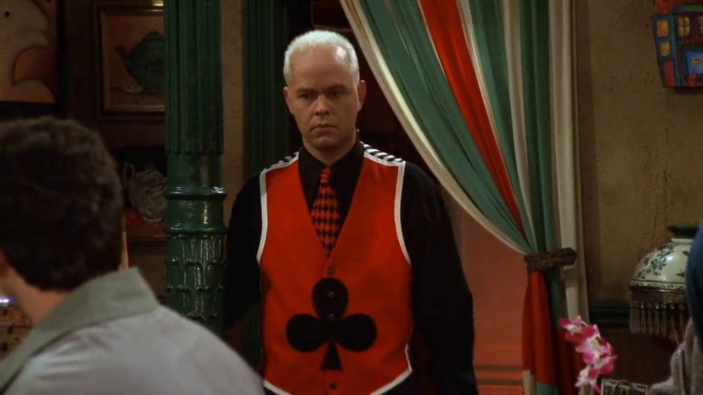
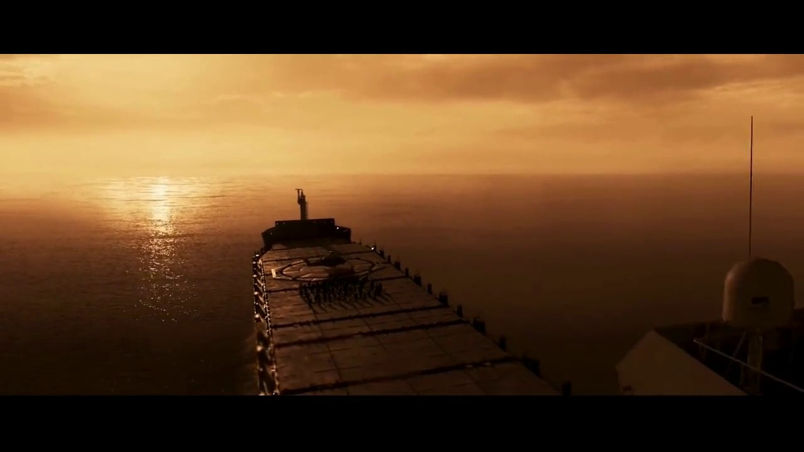
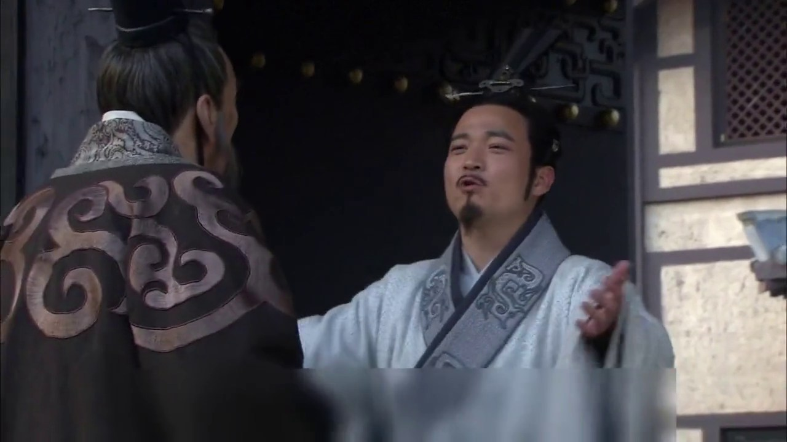
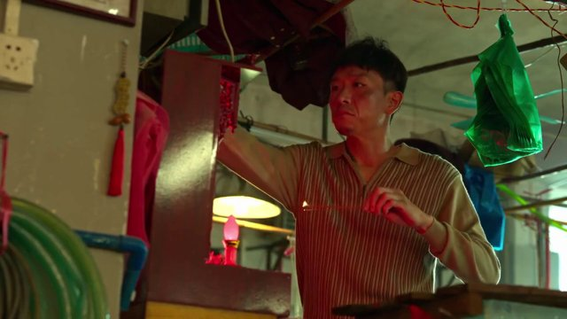
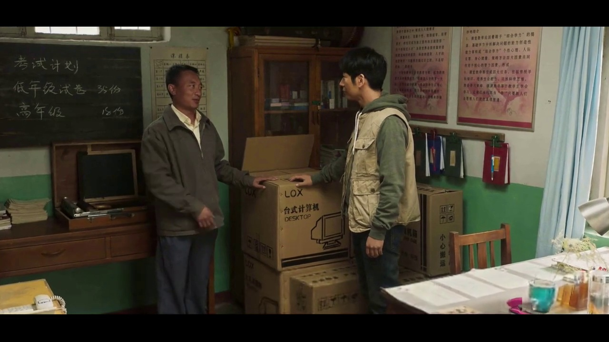
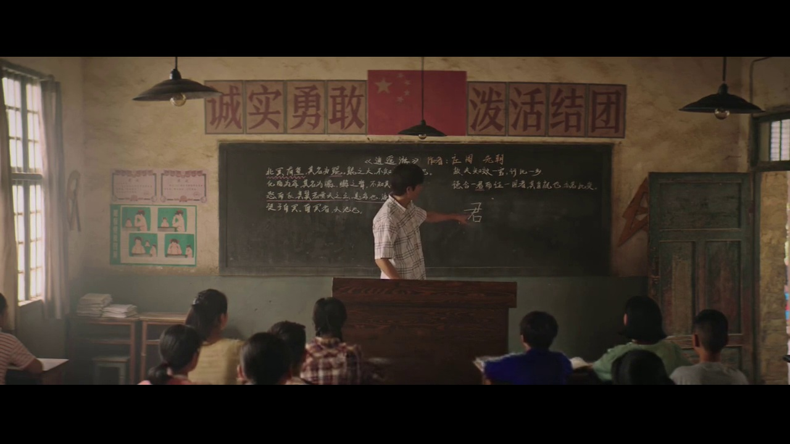

<div align="center">

<p>
  <picture>
    <source media="(max-width: 480px)" srcset="assets/logo/dramavqa-header-mobile.png">
    
  </picture>
</p>

<p>
  <a href="https://arxiv.org/abs/2611.00769"></a> &nbsp;
  <a href="https://huggingface.co/datasets/198808xc/drama_bench_data"></a> &nbsp;
  <a href="LICENSE"></a>
</p>

<p><a href="https://arxiv.org/abs/2611.00769">Paper</a> · <a href="#question-categories">Categories</a> · <a href="#qa-examples">QA Examples</a> · <a href="#data">Data</a> · <a href="#evaluation">Evaluation</a> · <a href="#leaderboard">Leaderboard</a> · <a href="#citation">Citation</a></p>

</div>

<a name="overview"></a>

## 🎬 Overview

DramaVQA benchmarks detailed understanding of ultra-long TV dramas. We process **15 dramas totaling approximately 606 hours**: **12 dramas (466 hours)** form the evaluation benchmark, and **3 additional dramas** form a separate training split with **86,736 questions**.

The evaluation benchmark includes **20,000 single-point questions (Full)**, a **2,000-question single-point Mini subset**, **3,200 multi-point questions**, and **1,200 multi-hop questions**. These tasks probe detailed visual understanding, information integration, and reasoning across long narratives.

<a name="data-generation"></a>

### ⚙️ Data generation

Metadata extraction and hierarchical captioning are followed by QA generation, filtering, human verification, and global uniqueness checks.

<p align="center">
  <a href="assets/data_generation_pipeline.png"></a>
</p>

<a name="question-categories"></a>

### 🧩 Question categories

**7 major categories · 28 subcategories**

<p align="center">
  <a href="assets/question_categories.png"></a>
</p>

**Categories and subcategories · 20,000 questions**

| Category | Questions (Full) | Subcategories |
| --- | ---: | --- |
| Visual Perception | 4,966 | Character Clothing; Character Hairstyle; Distinctive Features; Object Appearance; Object Presence; Season and Weather; Scene and Location; Textual Content |
| Spatial Understanding | 1,409 | Spatial Location; Position Comparison; Shooting Perspective |
| Action and Interaction | 5,290 | Body Movement; Action Claim Subject; Action Recipient; Object Motion |
| Event Understanding | 1,981 | Event Summary; Event Background; Event Outcome; Character Motivation |
| Temporal Understanding | 2,710 | Character Change; State Transition; Temporal Sequence; Temporal Comparison |
| Relation & Logical Reasoning | 1,868 | Human-Object Relation; Character Relation; Causal Inference |
| Counting | 1,776 | Object Counting; Quantity Comparison |
| **Total** | **20,000** | **28 subcategories** |

<a name="qa-examples"></a>

## 📝 QA Examples

<details name="qa-examples" open>
<summary><strong>Visual Perception / 视觉感知</strong> · Friends / 老友记</summary>

<div class="qa-body">

<div class="qa-heading">

<p class="qa-subcategory"><strong>Character Clothing / 人物服装</strong></p>

<p class="qa-question"><strong>In the final shot of Gunther after he drops the cup, what is the specific symbol and its color on his red vest?</strong><br><span lang="zh-CN">在杯子掉落后 Gunther 的最后一个镜头里，他的红色马甲上是什么符号、什么颜色？</span></p>

</div>

<div class="qa-media">

<p align="left"></p>

</div>

<p class="qa-options-label"><strong>Options / 选项</strong></p>

<table class="qa-options" aria-label="Options / 选项"><tbody><tr><td width="40" align="center" valign="middle"><strong>A</strong></td><td width="700" valign="top">A black club symbol<br><span lang="zh-CN">黑色梅花符号</span></td></tr>
<tr><td width="40" align="center" valign="middle"><strong>B</strong></td><td width="700" valign="top">A white spade symbol<br><span lang="zh-CN">白色黑桃符号</span></td></tr>
<tr><td width="40" align="center" valign="middle"><strong>C</strong></td><td width="700" valign="top">A green circle symbol<br><span lang="zh-CN">绿色圆圈符号</span></td></tr>
<tr><td width="40" align="center" valign="middle"><strong>D</strong></td><td width="700" valign="top">A yellow diamond symbol<br><span lang="zh-CN">黄色菱形符号</span></td></tr>
<tr><td width="40" align="center" valign="middle"><strong>E</strong></td><td width="700" valign="top">A blue star symbol<br><span lang="zh-CN">蓝色星形符号</span></td></tr>
<tr><td width="40" align="center" valign="middle"><strong>F</strong></td><td width="700" valign="top">A red heart symbol<br><span lang="zh-CN">红色爱心符号</span></td></tr></tbody></table>

<details class="qa-answer">
<summary><strong>Answer / 答案</strong></summary>

<blockquote><p><strong>A. A black club symbol</strong><br><span lang="zh-CN">黑色梅花符号</span></p></blockquote>

</details>

</div>

<!-- V16: DramaVQA/Bench_Data/friends.json | /1238/Q&A/1 | L2: 0067-00:00:00.000_0067-00:01:08.204. Source annotation unchanged; second-language text is a display translation. -->

</details>

<details name="qa-examples">
<summary><strong>Spatial Understanding / 空间理解</strong> · Three-Body / 三体</summary>

<div class="qa-body">

<div class="qa-heading">

<p class="qa-subcategory"><strong>Spatial Location / 空间位置</strong></p>

<p class="qa-question"><strong>On the golden sea nineteen years earlier, where on the large ship is the circular helipad located?</strong><br><span lang="zh-CN">19年前的金色海洋上，巨轮的圆形停机坪位于船体的哪个位置？</span></p>

</div>

<div class="qa-media">

<p align="left"></p>

</div>

<p class="qa-options-label"><strong>Options / 选项</strong></p>

<table class="qa-options" aria-label="Options / 选项"><tbody><tr><td width="40" align="center" valign="middle"><strong>A</strong></td><td width="700" valign="top">On the starboard deck<br><span lang="zh-CN">右侧甲板</span></td></tr>
<tr><td width="40" align="center" valign="middle"><strong>B</strong></td><td width="700" valign="top">At the stern<br><span lang="zh-CN">船尾</span></td></tr>
<tr><td width="40" align="center" valign="middle"><strong>C</strong></td><td width="700" valign="top">In the middle of the ship<br><span lang="zh-CN">船体中部</span></td></tr>
<tr><td width="40" align="center" valign="middle"><strong>D</strong></td><td width="700" valign="top">On the port deck<br><span lang="zh-CN">左侧甲板</span></td></tr>
<tr><td width="40" align="center" valign="middle"><strong>E</strong></td><td width="700" valign="top">On top of the bridge<br><span lang="zh-CN">驾驶舱顶部</span></td></tr>
<tr><td width="40" align="center" valign="middle"><strong>F</strong></td><td width="700" valign="top">At the bow<br><span lang="zh-CN">船头</span></td></tr></tbody></table>

<details class="qa-answer">
<summary><strong>Answer / 答案</strong></summary>

<blockquote><p><strong>F. At the bow</strong><br><span lang="zh-CN">船头</span></p></blockquote>

</details>

</div>

<!-- S4: DramaVQA/Bench_Data/three_body.json | /414/Q&A/0 | L2: 0019-00:06:52.680_0019-00:07:52.720. Source annotation unchanged; second-language text is a display translation. -->

</details>

<details name="qa-examples">
<summary><strong>Action and Interaction / 动作与交互</strong> · The Qin Empire II: Alliance / 大秦帝国之纵横</summary>

<div class="qa-body">

<div class="qa-heading">

<p class="qa-subcategory"><strong>Body Movement / 身体动作</strong></p>

<p class="qa-question"><strong>Just as Zhao Yang is about to enter the residence, what specific movement does Zhang Yi make to block his departure and keep the conversation going?</strong><br><span lang="zh-CN">在昭阳即将进入府门的那一刻，张仪为了阻止他离开并继续对话，采取了什么具体的拦截动作？</span></p>

</div>

<div class="qa-media">

<p align="left"></p>

</div>

<p class="qa-options-label"><strong>Options / 选项</strong></p>

<table class="qa-options" aria-label="Options / 选项"><tbody><tr><td width="40" align="center" valign="middle"><strong>A</strong></td><td width="700" valign="top">He draws his sword and holds it across the entrance<br><span lang="zh-CN">拔出佩剑横在门前</span></td></tr>
<tr><td width="40" align="center" valign="middle"><strong>B</strong></td><td width="700" valign="top">He kneels and clings to Zhao Yang's legs<br><span lang="zh-CN">跪在地上抱住昭阳的腿</span></td></tr>
<tr><td width="40" align="center" valign="middle"><strong>C</strong></td><td width="700" valign="top">He quickly closes the gate<br><span lang="zh-CN">迅速关上府门</span></td></tr>
<tr><td width="40" align="center" valign="middle"><strong>D</strong></td><td width="700" valign="top">He shouts loudly for the guards<br><span lang="zh-CN">大声呼喊卫兵</span></td></tr>
<tr><td width="40" align="center" valign="middle"><strong>E</strong></td><td width="700" valign="top">He grabs Zhao Yang's shoulder<br><span lang="zh-CN">用手抓住昭阳的肩膀</span></td></tr>
<tr><td width="40" align="center" valign="middle"><strong>F</strong></td><td width="700" valign="top">He spreads both arms to block the way<br><span lang="zh-CN">伸开双臂拦住去路</span></td></tr>
<tr><td width="40" align="center" valign="middle"><strong>G</strong></td><td width="700" valign="top">He throws his body against Zhao Yang<br><span lang="zh-CN">用身体撞向昭阳</span></td></tr></tbody></table>

<details class="qa-answer">
<summary><strong>Answer / 答案</strong></summary>

<blockquote><p><strong>F. He spreads both arms to block the way</strong><br><span lang="zh-CN">伸开双臂拦住去路</span></p></blockquote>

</details>

</div>

<!-- A7: DramaVQA/Bench_Data/qin_empire_2.json | /154/Q&A/0 | L2: 0009-00:03:36.120_0009-00:04:44.120. Source annotation unchanged; second-language text is a display translation. -->

</details>

<details name="qa-examples">
<summary><strong>Event Understanding / 事件理解</strong> · Ode to Joy / 欢乐颂</summary>

<div class="qa-body">

<div class="qa-heading">

<p class="qa-subcategory"><strong>Event Outcome / 事件结果</strong></p>

<p class="qa-question"><strong>At the science museum, what is the final result of Andy and Wei Wei's competition on the "Sharp Eyes, Quick Hands" game?</strong><br><span lang="zh-CN">在科技馆内，安迪和魏渭进行的“眼明手快”游戏比赛，最终的结果是什么？</span></p>

</div>

<div class="qa-media">

<p align="left"></p>

</div>

<p class="qa-options-label"><strong>Options / 选项</strong></p>

<table class="qa-options" aria-label="Options / 选项"><tbody><tr><td width="40" align="center" valign="middle"><strong>A</strong></td><td width="700" valign="top">Wei Wei wins<br><span lang="zh-CN">魏渭取得了胜利</span></td></tr>
<tr><td width="40" align="center" valign="middle"><strong>B</strong></td><td width="700" valign="top">The machine malfunctions and the competition is interrupted<br><span lang="zh-CN">游戏机出现故障，比赛中断</span></td></tr>
<tr><td width="40" align="center" valign="middle"><strong>C</strong></td><td width="700" valign="top">They do not finish because they disagree about the rules<br><span lang="zh-CN">两人因规则分歧没有完成比赛</span></td></tr>
<tr><td width="40" align="center" valign="middle"><strong>D</strong></td><td width="700" valign="top">Andy wins by a narrow margin<br><span lang="zh-CN">安迪以微弱优势获胜</span></td></tr>
<tr><td width="40" align="center" valign="middle"><strong>E</strong></td><td width="700" valign="top">They tie<br><span lang="zh-CN">两人打成了平手</span></td></tr>
<tr><td width="40" align="center" valign="middle"><strong>F</strong></td><td width="700" valign="top">Andy gives up partway through<br><span lang="zh-CN">安迪中途放弃了比赛</span></td></tr>
<tr><td width="40" align="center" valign="middle"><strong>G</strong></td><td width="700" valign="top">The result is not shown<br><span lang="zh-CN">比赛结果没有显示</span></td></tr></tbody></table>

<details class="qa-answer">
<summary><strong>Answer / 答案</strong></summary>

<blockquote><p><strong>A. Wei Wei wins</strong><br><span lang="zh-CN">魏渭取得了胜利</span></p></blockquote>

</details>

</div>

<!-- E5: DramaVQA/Bench_Data/ode_to_joy_1.json | /204/Q&A/1 | L2: 0011-00:07:49.600_0011-00:09:02.000. Source annotation unchanged; second-language text is a display translation. -->

</details>

<details name="qa-examples">
<summary><strong>Temporal Understanding / 时间理解</strong> · The Knockout / 狂飙</summary>

<div class="qa-body">

<div class="qa-heading">

<p class="qa-subcategory"><strong>Temporal Sequence / 时间顺序</strong></p>

<p class="qa-question"><strong>What is the first thing Lao Mo does immediately after finishing his prayer?</strong><br><span lang="zh-CN">老默在完成祈祷之后，他紧接着做的第一件事是什么？</span></p>

</div>

<div class="qa-media">

<p align="left"></p>

</div>

<p class="qa-options-label"><strong>Options / 选项</strong></p>

<table class="qa-options" aria-label="Options / 选项"><tbody><tr><td width="40" align="center" valign="middle"><strong>A</strong></td><td width="700" valign="top">Tidies the shrine<br><span lang="zh-CN">整理神龛</span></td></tr>
<tr><td width="40" align="center" valign="middle"><strong>B</strong></td><td width="700" valign="top">Takes off his apron<br><span lang="zh-CN">脱下围裙</span></td></tr>
<tr><td width="40" align="center" valign="middle"><strong>C</strong></td><td width="700" valign="top">Blows out the incense<br><span lang="zh-CN">吹灭香火</span></td></tr>
<tr><td width="40" align="center" valign="middle"><strong>D</strong></td><td width="700" valign="top">Softly calls out to Yaoyao<br><span lang="zh-CN">轻声呼唤瑶瑶</span></td></tr>
<tr><td width="40" align="center" valign="middle"><strong>E</strong></td><td width="700" valign="top">Picks up the black cloth bag<br><span lang="zh-CN">提起黑布包</span></td></tr>
<tr><td width="40" align="center" valign="middle"><strong>F</strong></td><td width="700" valign="top">Puts on his coat<br><span lang="zh-CN">换上外套</span></td></tr></tbody></table>

<details class="qa-answer">
<summary><strong>Answer / 答案</strong></summary>

<blockquote><p><strong>D. Softly calls out to Yaoyao</strong><br><span lang="zh-CN">轻声呼唤瑶瑶</span></p></blockquote>

</details>

</div>

<!-- T1: DramaVQA/Bench_Data/the_knockout.json | /510/Q&A/3 | L2: 0024-00:26:46.160_0024-00:27:39.600. Source annotation unchanged; second-language text is a display translation. -->

</details>

<details name="qa-examples">
<summary><strong>Relation &amp; Logical Reasoning / 关系与逻辑推理</strong> · Minning Town / 山海情</summary>

<div class="qa-body">

<div class="qa-heading">

<p class="qa-subcategory"><strong>Causal Inference / 因果推理</strong></p>

<p class="qa-question"><strong>In the office at Xigebi Primary School, why have the brand-new computers been left unused in a corner even though the school urgently needs them?</strong><br><span lang="zh-CN">在西戈壁小学的办公室里，那几台崭新的电脑明明是学校急需的设备，却为何一直被闲置在角落里？</span></p>

</div>

<div class="qa-media">

<p align="left"></p>

</div>

<p class="qa-options-label"><strong>Options / 选项</strong></p>

<table class="qa-options" aria-label="Options / 选项"><tbody><tr><td width="40" align="center" valign="middle"><strong>A</strong></td><td width="700" valign="top">The donor asked them to wait for professionals to install the computers together<br><span lang="zh-CN">因为捐赠方要求等专业人员来统一安装</span></td></tr>
<tr><td width="40" align="center" valign="middle"><strong>B</strong></td><td width="700" valign="top">The computers are intended for upper-grade pupils, but the school does not have any yet<br><span lang="zh-CN">因为电脑是为高年级学生准备的，但目前还没有</span></td></tr>
<tr><td width="40" align="center" valign="middle"><strong>C</strong></td><td width="700" valign="top">The teachers lack the knowledge and skills to operate computers<br><span lang="zh-CN">因为学校的老师们缺乏操作电脑的知识和技能</span></td></tr>
<tr><td width="40" align="center" valign="middle"><strong>D</strong></td><td width="700" valign="top">The computers' operating systems and software have not yet been purchased<br><span lang="zh-CN">因为电脑的操作系统和软件还没有购买</span></td></tr>
<tr><td width="40" align="center" valign="middle"><strong>E</strong></td><td width="700" valign="top">Principal Bai believes using computers will harm pupils' eyesight<br><span lang="zh-CN">因为白校长认为使用电脑会影响学生视力</span></td></tr>
<tr><td width="40" align="center" valign="middle"><strong>F</strong></td><td width="700" valign="top">The school's electricity supply is insufficient to run the computers<br><span lang="zh-CN">因为学校电力供应不足，无法支持电脑运行</span></td></tr></tbody></table>

<details class="qa-answer">
<summary><strong>Answer / 答案</strong></summary>

<blockquote><p><strong>C. The teachers lack the knowledge and skills to operate computers</strong><br><span lang="zh-CN">因为学校的老师们缺乏操作电脑的知识和技能</span></p></blockquote>

</details>

</div>

<!-- R4: DramaVQA/Bench_Data/minning_town.json | /335/Q&A/5 | L2: 0017-00:11:25.155_0017-00:12:50.373. Source annotation unchanged; second-language text is a display translation. -->

</details>

<details name="qa-examples">
<summary><strong>Counting / 计数</strong> · The Long Night / 沉默的真相</summary>

<div class="qa-body">

<div class="qa-heading">

<p class="qa-subcategory"><strong>Object Counting / 物体计数</strong></p>

<p class="qa-question"><strong>In the rural classroom scene with teacher Hou Guiping, how many old-fashioned pendant lamps can clearly be seen hanging from the ceiling?</strong><br><span lang="zh-CN">在侯贵平老师的乡村教室片段中，可以明确看到天花板上悬挂着多少盏老式吊灯？</span></p>

</div>

<div class="qa-media">

<p align="left"></p>

</div>

<p class="qa-options-label"><strong>Options / 选项</strong></p>

<table class="qa-options" aria-label="Options / 选项"><tbody><tr><td width="40" align="center" valign="middle"><strong>A</strong></td><td width="700" valign="top">Two<br><span lang="zh-CN">两盏</span></td></tr>
<tr><td width="40" align="center" valign="middle"><strong>B</strong></td><td width="700" valign="top">One<br><span lang="zh-CN">一盏</span></td></tr>
<tr><td width="40" align="center" valign="middle"><strong>C</strong></td><td width="700" valign="top">There are no pendant lamps; they are fluorescent tubes<br><span lang="zh-CN">没有吊灯，是日光灯管</span></td></tr>
<tr><td width="40" align="center" valign="middle"><strong>D</strong></td><td width="700" valign="top">Four<br><span lang="zh-CN">四盏</span></td></tr>
<tr><td width="40" align="center" valign="middle"><strong>E</strong></td><td width="700" valign="top">Three<br><span lang="zh-CN">三盏</span></td></tr>
<tr><td width="40" align="center" valign="middle"><strong>F</strong></td><td width="700" valign="top">Six<br><span lang="zh-CN">六盏</span></td></tr>
<tr><td width="40" align="center" valign="middle"><strong>G</strong></td><td width="700" valign="top">Five<br><span lang="zh-CN">五盏</span></td></tr></tbody></table>

<details class="qa-answer">
<summary><strong>Answer / 答案</strong></summary>

<blockquote><p><strong>E. Three</strong><br><span lang="zh-CN">三盏</span></p></blockquote>

</details>

</div>

<!-- C3: DramaVQA/Bench_Data/the_long_night.json | /69/Q&A/0 | L2: 0004-00:13:08.200_0004-00:14:21.920. Source annotation unchanged; second-language text is a display translation. -->

</details>

<a name="data"></a>

## 📦 Data

Question annotations are included in this repository. Videos and metadata are available on [Hugging Face](https://huggingface.co/datasets/198808xc/drama_bench_data).

| Collection | Directory | Questions | Dramas |
| --- | --- | ---: | ---: |
| Single-point Full | [`DramaVQA/Bench_Data/`](DramaVQA/Bench_Data/) | 20,000 | 12 |
| Single-point Mini | [`DramaVQA/Bench_Data_mini_2000/`](DramaVQA/Bench_Data_mini_2000/) | 2,000 | 12 |
| Multi-point | [`DramaVQA/Multi-Point/`](DramaVQA/Multi-Point/) | 3,200 | 12 |
| Multi-hop | [`DramaVQA/Multi-Hop/`](DramaVQA/Multi-Hop/) | 1,200 | 12 |
| Training | [`DramaVQA/Training_Set/`](DramaVQA/Training_Set/) | 86,736 | 3 |

Mini is a subset of Full. The three training dramas are separate from the evaluation dramas.

<a name="download"></a>

### 📥 Download

Clone the repository and download media for one evaluation drama, for example [*The Knockout* (狂飙)](DramaVQA/Bench_Data/the_knockout.json):

```bash
git clone https://github.com/xinyuehuo/DramaVQA.git
cd DramaVQA
python -m pip install --upgrade huggingface_hub
hf download 198808xc/drama_bench_data --repo-type dataset \
  --include "the_knockout/*" --local-dir data/drama_bench_data
```

Change `--include` for another drama, or omit it to download all media.

<a name="evaluation"></a>

## 🧪 Evaluation

Single-point QA is evaluated across four temporal tracks:

| Track | Average input duration |
| --- | --- |
| Medium | 7.6 minutes |
| Long | 43.1 minutes |
| Extra-Long | 9.3 hours |
| Ultra-Long (full drama) | 38.9 hours |

See the **[Evaluation Guide](evaluate/README.md)** for single-point, multi-point, and multi-hop evaluation, including setup and the **validate → prepare → run** workflow.

<a name="leaderboard"></a>

## 🏆 Leaderboard

Ranked by **Medium (L3)** accuracy.

**Frames:** sampled frames (`var` = variable). **Think:** ✓ on / — off. <sup>P</sup>: proprietary model.

<!-- Transcribed from the active tab:main_results in iclr_dramavqa_release.tex.
     Each LaTeX cell is Mini accuracy / Full accuracy / Mini inference time.
     Preserve model labels and settings from that table, not commented drafts. -->

<details open>
<summary><strong>Mini · 2,000 questions</strong></summary>

| Rank | Model | Frames | Think | Medium | Long | Extra-Long | Ultra-Long |
| :--: | --- | ---: | :--: | ---: | ---: | ---: | ---: |
| 🥇 1 | Gemini-3.5-Flash<sup>P</sup> | 256 | — | **77.5** | **61.2** | **43.9** | **37.1** |
| 🥈 2 | GLM-5.3-Flash-FP8 | 512 | ✓ | 75.4 | 56.1 | 36.1 | 32.1 |
| 🥉 3 | Seed2.0 Pro<sup>P</sup> | 256 | ✓ | 73.2 | 49.2 | 32.2 | 30.7 |
| 4 | Qwen3.6-27B | 512 | — | 72.5 | 55.0 | 37.9 | 34.1 |
| 5 | Qwen3.5-27B | 512 | — | 72.2 | 51.0 | 37.1 | 33.9 |
| 6 | GLM-5.3-Flash-FP8 | 256 | ✓ | 70.5 | 49.9 | 34.9 | 32.1 |
| 7 | Qwen3.6-27B | 256 | — | 69.9 | 48.0 | 35.2 | 33.0 |
| 8 | Qwen3.5-27B | 256 | — | 69.4 | 47.1 | 35.7 | 34.4 |
| 9 | GPT-5.5<sup>P</sup> | 256 | — | 67.2 | 45.2 | 29.9 | 27.6 |
| 10 | LongVideo-R1 (post-tuned) | var | ✓ | 66.1 | 60.0 | 40.0 | 30.8 |
| 10 | Qwen3-VL-32B | 512 | ✓ | 66.1 | 43.7 | 26.4 | 24.1 |
| 12 | LongVideo-R1 | var | ✓ | 62.8 | 54.8 | 34.7 | 27.2 |
| 13 | Qwen3-VL-32B | 256 | ✓ | 62.0 | 37.9 | 26.4 | 24.9 |
| 14 | GLM-4.6V-106B | 512 | ✓ | 60.8 | 40.1 | 25.6 | 24.6 |
| 15 | Naive-RAG (Q3.8) | var | — | 60.1 | 56.7 | 36.9 | 31.5 |
| 16 | Qwen3-VL-8B | 512 | ✓ | 57.2 | 40.0 | 26.9 | 25.0 |
| 17 | GLM-4.6V-106B | 256 | ✓ | 57.1 | 36.6 | 27.1 | 25.4 |
| 18 | RAG-BS (Q3.8) | var | — | 56.4 | 40.4 | 32.1 | 30.9 |
| 19 | GLM-4.6V-106B | 512 | — | 55.0 | 37.0 | 27.4 | 26.6 |
| 20 | Qwen3-VL-32B | 512 | — | 54.8 | 35.8 | 28.2 | 25.4 |
| 21 | Qwen3-VL-8B | 256 | ✓ | 54.2 | 36.5 | 24.6 | 23.4 |
| 22 | Naive-RAG (Q3) | var | — | 51.7 | 46.6 | 29.7 | 26.3 |
| 23 | GLM-4.6V-106B | 256 | — | 51.0 | 34.5 | 27.4 | 26.5 |
| 23 | Qwen3-VL-32B | 256 | — | 51.0 | 35.1 | 27.8 | 26.4 |
| 25 | Conan | 512 | ✓ | 49.0 | 37.7 | 29.7 | 29.6 |
| 26 | Conan | 256 | ✓ | 48.8 | 36.3 | 29.7 | 28.6 |
| 27 | RAG-BS (Q3) | var | — | 47.4 | 33.5 | 25.8 | 24.8 |
| 28 | Qwen3-VL-8B | 512 | — | 41.7 | 30.4 | 24.1 | 22.6 |
| 29 | Qwen3-VL-8B | 256 | — | 40.9 | 28.7 | 24.8 | 22.7 |

</details>

<details>
<summary><strong>Full · 20,000 questions</strong></summary>

| Rank | Model | Frames | Think | Medium | Long | Extra-Long | Ultra-Long |
| :--: | --- | ---: | :--: | ---: | ---: | ---: | ---: |
| 🥇 1 | Qwen3.6-27B | 512 | — | **70.8** | 54.9 | 38.6 | **35.1** |
| 🥈 2 | LongVideo-R1 (post-tuned) | var | ✓ | 67.5 | **61.4** | **40.9** | 30.5 |
| 🥉 3 | Qwen3.6-27B | 256 | — | 67.1 | 49.5 | 36.9 | 34.6 |
| 4 | LongVideo-R1 | var | ✓ | 63.7 | 55.3 | 34.0 | 26.6 |
| 5 | Naive-RAG (Q3.8) | var | — | 59.8 | 56.1 | 36.8 | 32.7 |
| 6 | Qwen3-VL-8B | 512 | ✓ | 58.9 | 41.0 | 27.5 | 25.2 |
| 7 | Qwen3-VL-8B | 256 | ✓ | 56.3 | 37.7 | 26.7 | 24.9 |
| 8 | RAG-BS (Q3.8) | var | — | 56.0 | 41.1 | 32.7 | 31.5 |
| 9 | Qwen3-VL-32B | 512 | — | 53.3 | 37.2 | 27.5 | 26.2 |
| 10 | Qwen3-VL-32B | 256 | — | 51.3 | 35.0 | 27.4 | 25.9 |
| 11 | Naive-RAG (Q3) | var | — | 50.4 | 45.9 | 29.1 | 25.3 |
| 12 | Conan | 256 | ✓ | 50.1 | 37.1 | 30.9 | 29.9 |
| 13 | Conan | 512 | ✓ | 48.8 | 37.9 | 30.5 | 29.5 |
| 14 | RAG-BS (Q3) | var | — | 47.1 | 33.7 | 25.7 | 24.7 |
| 15 | Qwen3-VL-8B | 512 | — | 42.5 | 31.1 | 25.4 | 24.2 |
| 16 | Qwen3-VL-8B | 256 | — | 42.3 | 30.2 | 25.1 | 24.1 |

</details>

<details>
<summary><strong>Reference scores and settings</strong></summary>

No-vision reference scores apply to all four tracks.

| Reference | Think | Mini | Full |
| --- | :--: | ---: | ---: |
| Random guess | — | 16.2 | 16.2 |
| Language only (Q3) | — | 21.5 | 22.2 |
| Language only (Q3.5) | ✓ | 23.1 | 23.3 |

Human reference: **81.0% on Mini / Medium**.

- **Backbones:** Q3 = Qwen3-VL-32B; Q3.5 = Qwen3.5-27B; Q3.8 = Qwen3.8-27B.
- **Post-tuning:** LongVideo-R1 (post-tuned) uses our training data.
- **Settings:** see the [paper](https://arxiv.org/abs/2611.00769) and [evaluation guide](evaluate/README.md).

</details>

<a name="citation"></a>

## 📖 Citation

If you use DramaVQA in your research, please cite our [arXiv paper](https://arxiv.org/abs/2611.00769):

```bibtex
@misc{huo2026dramavqa,
  title         = {DramaVQA: Probing Detailed Understanding of Ultra-Long TV Dramas},
  author        = {Huo, Xinyue and Chen, Pengfei and Ge, Jiannan and Duan, Kaiwen and Shao, Jiacheng and Cao, Yunning and Xie, Lingxi and Tian, Qi},
  year          = {2026},
  eprint        = {2611.00769},
  archivePrefix = {arXiv},
  primaryClass  = {cs.CV},
  url           = {https://arxiv.org/abs/2611.00769}
}
```

<a name="license"></a>

## 📜 License

The code and documentation in this repository are released under the **[MIT License](LICENSE)**.
